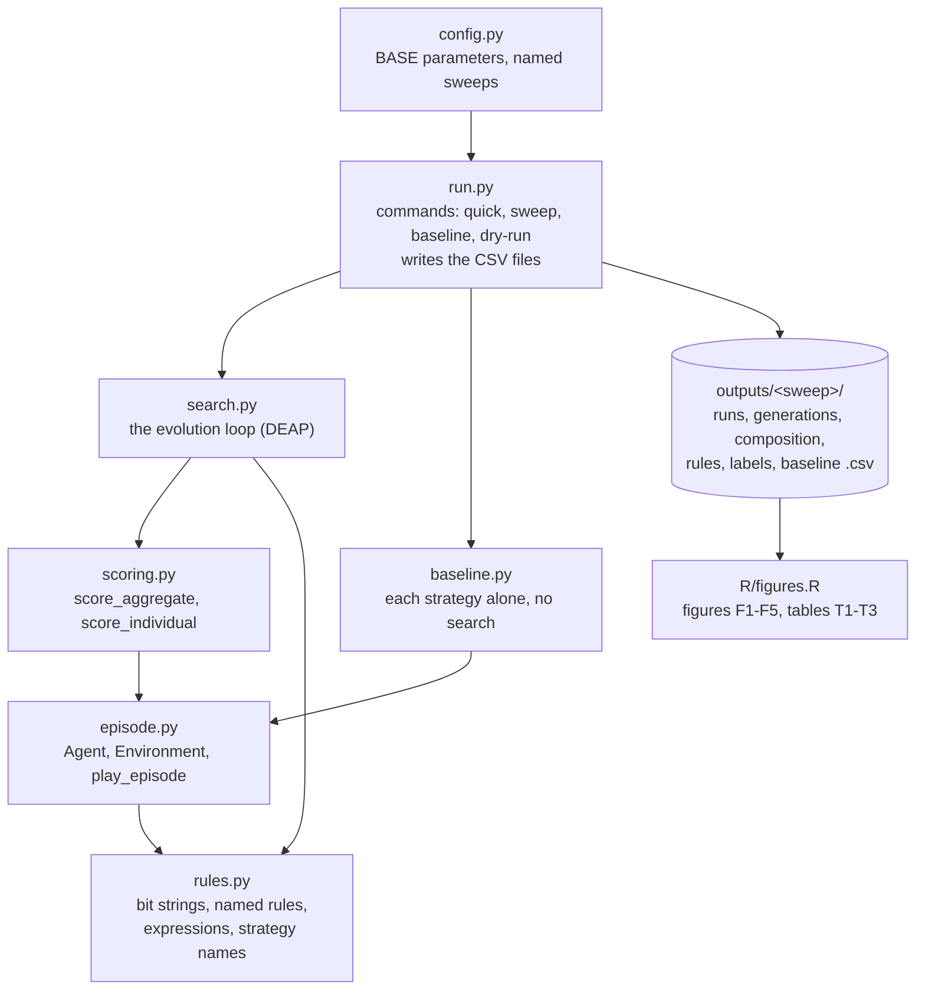
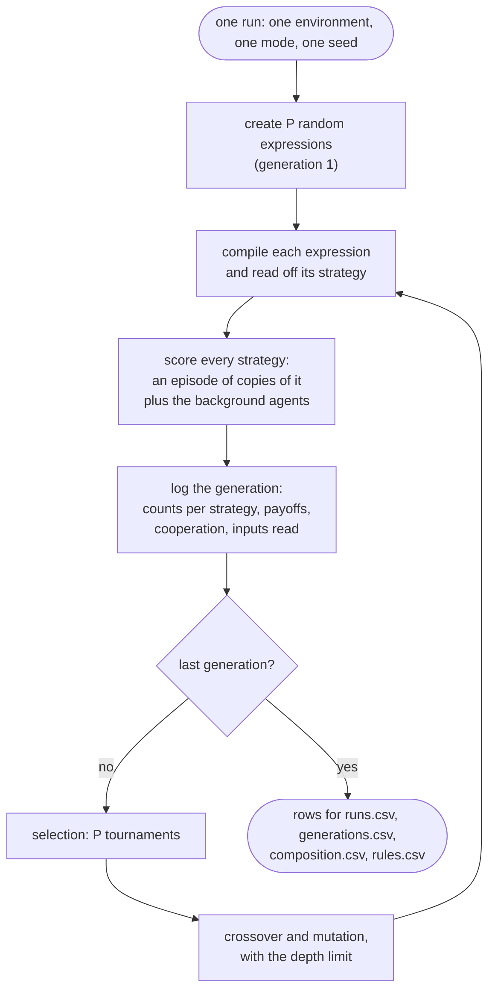

# A short guide to the iGSS reciprocity model

*AI-generated draft (Claude, Anthropic), for checking and amendment by the authors.*

This guide explains what the model does and how to read what it produces. It is an introduction, not the specification: `docs/SPEC.md` is the single source of truth, and where the two differ, SPEC.md is right. Section numbers in brackets point into SPEC.md.

---

## 1. What the model is for

The literature on cooperation names a small number of reciprocity strategies, such as "help those who helped you" and "help those in good standing". These are usually written down by a researcher and then entered into an evolutionary tournament.

This model asks a different question: **if nobody writes the strategy down, does a search find it?** Genetic programming is given a few arithmetic building blocks and one or two yes/no facts about the partner. It breeds formulas, and the model then reads off what each formula actually does. What is to be explained is the rule that evolves. [§1]

Nothing in the search knows which rule the literature favours. The canonical strategies are only labels attached to the output afterwards.

## 2. The game

Agents meet in random pairs. In each meeting one agent, the **donor**, decides whether to help its **partner**. Helping costs the donor `c` and gives the partner `b`, with `b` larger than `c`. Everyone gains if everyone helps, but each donor saves `c` by refusing. [§2, §4]

Three kinds of agent play together:

- **iGSS agents**, whose behaviour is being searched for;
- **unconditional cooperators**, who always help;
- **unconditional defectors**, who never help.

The two background kinds are the environment. A rule that helps everybody is exploited by the defectors; a rule that helps nobody gains nothing from the cooperators or from its own kind. A reciprocity strategy does well only if it can tell the two apart.

What an iGSS agent knows about its partner is one bit:

| Model | The bit the donor reads | Who sets it |
| --- | --- | --- |
| **DR**, direct reciprocity | its own **record** of this partner: did the partner help me last time it was my donor? | the agent itself, privately |
| **IR**, indirect reciprocity | the partner's public **standing**, 0 or 1 | a rule applied after every interaction, visible to all |

In both models 1 is the value that would normally favour helping, and every record and standing starts at 1.

An **episode** is a fixed number of rounds from a fresh start. In each round every agent acts once as donor. With a small probability an intended help fails (execution error).

## 3. Rules, bit strings and strategies

Two rules govern an agent. [§3, §5]

- The **action rule** turns the bit the donor reads into "help" or "refuse".
- The **assessment rule** turns what just happened into the new record or standing.

A rule with yes/no inputs can only do so many things, and each is written as a **bit string**: the rule's answer for every combination of inputs, all-ones first.

| Action rule | Helps when the bit is 1? | Helps when it is 0? | In words |
| --- | --- | --- | --- |
| `11` | yes | yes | always help |
| `10` | yes | no | follow the bit |
| `01` | no | yes | reverse the bit |
| `00` | no | no | never help |

An assessment rule has two inputs (what the donor did, and one other bit), so it has four answers and there are 16 of them, from `1111` to `0000`. For example `1100` means "the new value is what the donor just did". [§14]

A **strategy** is an action rule together with an assessment rule, written `action/assessment`: `10/1100` is "follow the bit, where the bit records what the partner last did". The literature's names attach to strategies, not to action rules alone. [§16]

The search does not evolve bit strings directly. It evolves **arithmetic expressions** built from `add`, `sub`, `mul`, the inputs and the constants 0 and 1, such as `sub(1, mul(0, partner_standing))`. The model compiles each expression, tries it on every input combination, and reads off its bit string. Many different expressions give the same bit string: the bit string is what the agent does, and the expression is how the search happened to write it. [§5, §9]

**Three modes** decide which rule evolves:

| Mode | Evolves | Held fixed | Possible strategies |
| --- | --- | --- | --- |
| 1 | the action rule | the assessment rule (the model's base rule) | 4 |
| 2 | the assessment rule | the action rule, `10` | 16 |
| 3 | both | nothing | 64, counted as 34 classes |

In mode 3, a strategy that always helps or never helps never looks at the stored value, so its assessment rule cannot matter. Such strategies are counted as one class each, `11/any` and `00/any`. [§14.3]

## 4. How a rule is scored

The present focus is **aggregate scoring**: a rule is scored by placing copies of it in every iGSS agent, playing an episode against the background agents, and taking the mean payoff per round of those copies. The question it answers is "how well does a group do when all its members use this rule?" [§7]

Under aggregate scoring the episode has one assessment rule, applied after every interaction whoever the donor and partner are. It can be thought of as the rule of a ledger that every agent can read.

Two consequences help when reading output:

- All rules of one generation are tested on the same random matchings, so differences in score come from the rules. Rules with the same strategy get exactly the same score.
- Two strategies that never get the chance to act differently also get exactly the same score. The search cannot prefer one to the other, and which one ends up more common is drift.

**Individual scoring**, in which different rules compete inside one episode, is also built. It is set aside for now. [§13]

## 5. How the search works

A run keeps a population of rules. In every generation each rule is scored, and the next population is bred from the better ones: rules are picked in small tournaments, pairs of them exchange pieces of formula (crossover), and some have a piece replaced at random (mutation). No rule is copied forward untouched. An optional **size penalty** lowers the score of long formulas. [§9]

A run does not return a winner. It returns **the composition of the population over time**: how many rules have each strategy in each generation.

## 6. Architecture



- Everything that plays the game goes through one function, `play_episode`. The baseline and the search therefore cannot disagree about the rules of the game.
- DEAP is used only in `search.py`.
- The figures are drawn from the CSV files alone, after the runs.

## 7. What happens in a run



A **sweep** is this run repeated for every combination of the parameters it varies, several seeds each. A **baseline** skips the search: it plays each possible strategy, alone, in each environment of the sweep.

## 8. Pseudocode

One episode [§4]:

```
play_episode(agents, environment, random numbers):
    every payoff = 0; every record and standing = 1
    repeat R times:                                  # one round
        shuffle the agents
        for each agent in turn, as donor:
            partner = a random other agent
            bit     = donor's record of partner      (DR)
                      or partner's standing          (IR)
            decision = donor's action rule applied to bit
                       (background agents: always help / never help)
            action   = decision, except that an intended help
                       fails with probability e_action
            if action is help: donor pays c, partner gains b
            apply the assessment rule to (action, other bit):
                DR: partner's record of donor is updated
                IR: donor's standing is updated
    return payoffs, cooperation counts, how often each bit value was read
```

Aggregate scoring of one generation [§7]:

```
score_aggregate(strategies of the generation):
    for each distinct strategy:
        agents = N_I copies of the strategy + cooperators + defectors
        play one episode (the same random numbers for every strategy)
        score  = mean payoff per round of the N_I copies
    return each rule's score
```

One run [§9]:

```
run(configuration, seed):
    population = P random expressions
    for generation = 1 .. G:
        strategies = classify(population)            # compile, read bit strings
        scores     = score_aggregate(strategies)
        selection score = score - size penalty x number of nodes
        log the generation
        if generation < G:
            parents    = P tournaments of 3 on the selection score
            population = crossover and mutation of the parents
```

## 9. Reading the output

Each sweep writes a folder under `outputs/`. [§10]

| File | What it holds |
| --- | --- |
| `runs.csv` | one row per run: the parameters and the final generation |
| `generations.csv` | one row per generation: most common strategy, payoffs, cooperation |
| `composition.csv` | how many rules had each strategy, per generation |
| `rules.csv` | the expressions themselves, for some generations |
| `baseline.csv` | from the baseline command: each strategy alone, per seed |

Strategies are written `TT:10/1100` and carry a `strategy_name`, which is the literature's name for that strategy or "unnamed". For example, in DR the output label of `10/1100` is "Tit-for-Tat".

A suggested order for a first look:

1. **The baseline first.** Figure F3 shows, for each environment, the payoff of each strategy among copies of itself. This is what aggregate scoring rewards, so it says what the search *should* find. Strategies with identical boxes cannot be told apart in that environment.
2. **Figure F2**: in what share of runs each strategy ended as the most common.
3. **Figure F1**: how the population changed over the generations.
4. **Table T3**: the same as F2 by bit string, to see what "unnamed" contains.

Three cautions:

- **A search that does not find the canonical strategy has not necessarily failed.** If the baseline shows that another strategy earns as much or more in that environment, the search is agreeing with the baseline. Only a strategy that the baseline ranks clearly first, and that the search still misses, counts against the search. [§10]
- **"Unnamed" is not "unknown behaviour".** Several unnamed strategies act exactly like a named one. For example, an assessment rule that never lowers a stored value turns `10` into "always help". Check T3 and the baseline before reading anything into the share of "unnamed".
- **Without defection there is nothing to reciprocate.** With no defectors and no execution error, the bit is always 1, and `10` behaves exactly like `11`. The columns `reads_one` and `reads_zero` show how often each value of the bit was actually met. [§6.3]

## 10. Running it

```
python -m igss.run quick --mode 1 --model DR --scoring aggregate     one short run, to see the files
python -m igss.run dry-run base                                      list what a sweep would run
python -m igss.run baseline base                                     the baseline for a sweep
python -m igss.run sweep base --workers 4                            the sweep itself, 4 runs at a time
Rscript R/figures.R outputs/<sweep folder> --baseline outputs/<baseline folder>
```

Parameters and sweeps are in `igss/config.py`: one dictionary of base values, and named sweeps that list the values some parameters take. [§11]

## 11. Where to go next

| To find | Read |
| --- | --- |
| The exact rules of the game | SPEC §4 |
| Bit strings and classification | SPEC §5 |
| Every choice made, and by whom | SPEC §13 |
| Modes 2 and 3 in detail | SPEC §14 |
| The literature's names | SPEC §16 |
| How the legacy code differed | SPEC §17, `docs/rebuild_plan.md` |
| A worked example of one episode, step by step | `tests/test_episode.py` (the two hand-checked traces) |
